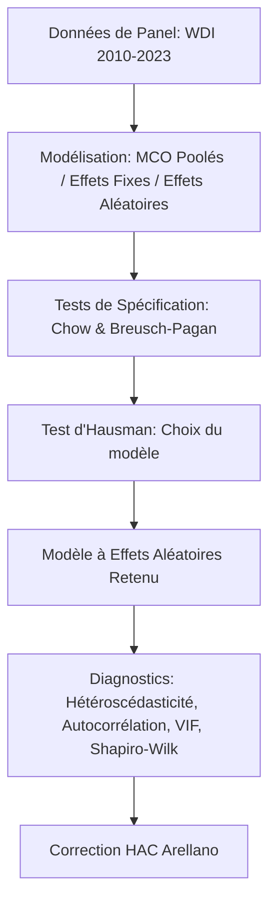

<div align="center">

  

  # 🌐 Internet, Haut Débit & Productivité du Travail dans l'UE (2010–2023)
  ### *Analyse Économétrique sur Données de Panel avec R*

  [](https://www.r-project.org/)
  [](https://cran.r-project.org/web/packages/plm/index.html)
  [](https://databank.worldbank.org/source/world-development-indicators)
  [](#)

</div>

---

## 🎯 Objectif du Projet

Ce projet vise à évaluer empiriquement l'impact de la pénétration d'Internet et du haut débit sur la **productivité du travail** (mesurée par le PIB par personne employée) à travers 15 pays membres de l'Union européenne sur la période **2010–2023**.

---

## 📊 Source des Données

- **Source :** Banque Mondiale — *World Development Indicators (WDI)*.
- **Nature des données :** Données de panel cylindriques (*Balanced Panel Data*).
- **Couverture :** 15 pays de l'Union européenne sur 14 années ($N = 15, T = 14$).

---

## 🔬 Méthodologie Économétrique



### 1. Estimation & Sélection de Modèles
- **Modèles évalués :** MCO poolés (*Pooled OLS*), Modèle à Effets Fixes (FE), Modèle à Effets Aléatoires (RE).
- **Tests de spécification :**
  - **Test de Chow :** Test de la présence d'effets individuels.
  - **Test de Breusch-Pagan :** Vérification des effets aléatoires non observés.
  - **Test d'Hausman :** Arbitrage entre Effets Fixes et Effets Aléatoires ($\text{H}_0$ non rejetée $\rightarrow$ **Effets Aléatoires retenus**).

### 2. Diagnostics & Robustesse
- **Hétéroscédasticité & Autocorrélation :** Détection de variance non constante et de corrélation temporelle des résidus.
- **Multicolinéarité :** Calcul du facteur d'inflation de la variance (*VIF*).
- **Normalité des résidus :** Test de Shapiro-Wilk.
- **Correction robuste :** Application de la matrice de covariance **HAC d'Arellano** pour ajuster les erreurs-types.

---

## 📈 Principaux Résultats

> 💡 **Enseignement clé :**  
> Avant correction, l'effet de la pénétration d'Internet sur la productivité est **positif et statistiquement significatif au seuil de 5 %**.  
> Néanmoins, après ajustement par des **erreurs-types robustes HAC (Arellano)**, le coefficient associé n'est plus statistiquement significatif, soulignant la nécessité de contrôler l'autocorrélation et l'hétéroscédasticité dans les panels macroéconomiques.

---

## 📁 Structure du Dépôt

```bash
.
├── panel_econometrie.R            # Script R (estimations, tests d'Hausman, diagnostics, correction HAC)
├── panel_digital_productivity.csv # Jeu de données de panel (Source: World Bank WDI)
├── Rapport_Econometrie_Panel.pdf # Rapport d'analyse complet et interprétations
├── header_banner.svg             # Graphique d'en-tête visualisant le réseau et le panel
└── README.md                     # Documentation du dépôt
```

---

## 🛠️ Outils & Bibliothèques R

- **`plm` :** Économétrie des données de panel (MCO, FE, RE, test d'Hausman, Arellano HAC).
- **`lmtest` & `sandwich` :** Tests d'hypothèses et matrices de covariance robustes.
- **`car` :** Calcul du VIF pour la multicolinéarité.
- **`ggplot2` & `tidyverse` :** Manipulation de données et visualisations économiques.

---

## 👩‍💻 Auteure

**Amina Mir** ([@amina-mir](https://github.com/amina-mir))  
*Master Économie Appliquée et Data Science*  
FSJES Meknès — Université Moulay Ismail

---

<div align="center">
  <i>Si ce projet d'économie numérique vous inspire, n'hésitez pas à lui ajouter une ⭐️ sur GitHub !</i>
</div>